# Dreame Vacuum Card State and Error

[](https://github.com/hacs/default)
[](https://github.com/LuigiPzz/dreame-vacuum-card-state-and-error/releases)
[](https://opensource.org/licenses/MIT)

Una custom card per **Home Assistant (Lovelace)** dal design minimale, moderno ed elegante progettata specificamente per robot aspirapolvere e lavapavimenti **Dreame** (ottimizzata per Dreame L10 Ultra / L10s / L20 / X40 e compatibili).

Offre un layout compatto, animazioni fluide ad alta fedeltà, grafica fotorealistica ufficiale e gestione intelligente di tutti gli stati operativi (pulizia, ritorno, ricarica, lavaggio moci, asciugatura ed errori con diagrammi tecnici dedicati).

---

<div align="center">

### 📸 Stati di Pulizia e Movimento

| 🧹 Aspira e Lava | 💨 Solo Aspirazione | 💧 Solo Lavaggio |
| :---: | :---: | :---: |
| 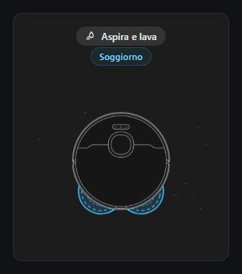 | 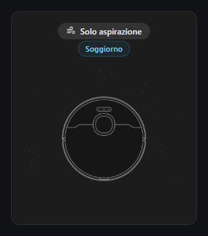 | 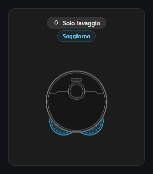 |

### 📸 Stati in Base Station & Manutenzione

| ⚡ In Ricarica | 💧 Lavaggio Moci | ♨️ Asciugatura |
| :---: | :---: | :---: |
| 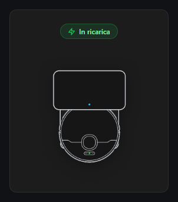 | 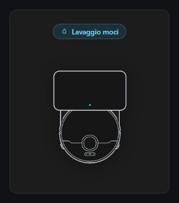 | 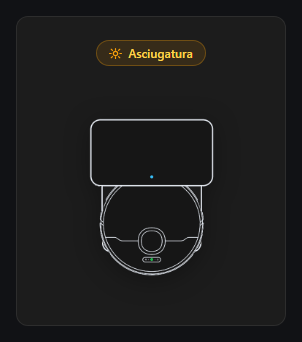 |

| 🏠 In Base (Standby) | ⬇️ Ritorno alla Base | ⏸️ In Pausa |
| :---: | :---: | :---: |
| 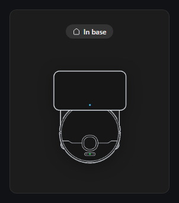 | 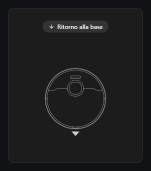 | 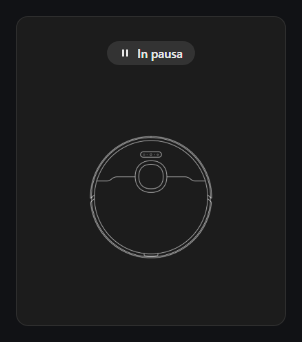 |

### 📸 Diagnostica Errori Tecnici

| ⚠️ Panni Staccati | ⚠️ Ruote Sollevate | ⚠️ Asse Lavaggio Mocio |
| :---: | :---: | :---: |
| 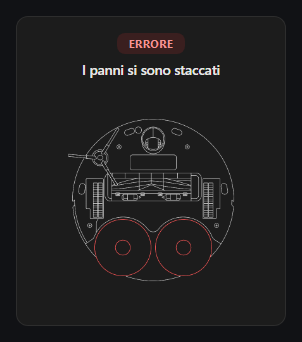 | 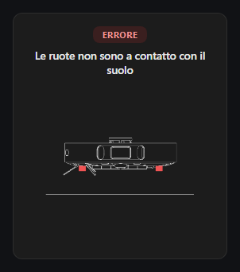 | 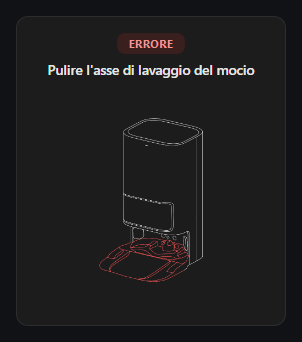 |

| ⚠️ Zona Non Raggiungibile | ⚠️ Serbatoio Acqua Pulita |
| :---: | :---: |
| 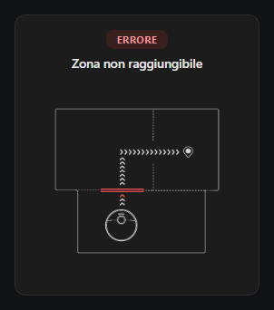 | 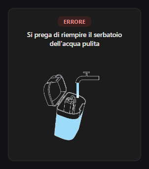 |

</div>

---

## ✨ Caratteristiche Principali

- 📐 **Compatibilità Nativa Sezioni Lovelace (Grid View)**:
  - Progettata su misura per la griglia standard di Home Assistant: larghezza predefinita a **6 colonne** e altezza a **5 righe standard** (~310px).
  - Allineamento millimetrico con card native e Mushroom, con quota fissa dell'area grafica per evitare sbalzi o ridimensionamenti tra uno stato e l'altro.
- 🎨 **Design Minimale & Asset Nativi Integrati**:
  - Palette dark neutra (`#1c1c1c`) con riflessi e accenti discreti.
  - Tutte le immagini ufficiali e i diagrammi di errore sono incorporati nativamente in Base64 all'interno del file JavaScript: zero file esterni da scaricare o copiare manualmente.
- 🔄 **Animazioni Realistiche Calibrate**:
  - **Movimento di Pulizia Fluido**: oscillazione combinata avanti-sinistra-destra (durata 3.36s) con traiettoria continua priva di pause centrali.
  - **Moci Rotanti Sagomati**: rotazione a velocità sincrona con maschera SVG che cela il 100% dell'ingombro interno al telaio del robot, mostrando unicamente le mezzelune sporgenti realistiche.
  - **Micro-particelle di Aspirazione**: flusso calmo e soffuso di particelle cyan fluttuanti verso la bocchetta di aspirazione.
- 🏷️ **Chip Concisi & Badge Stanza Pulito**:
  - Icona sempre singola per ogni modalità (glifo fuso per *"Aspira e lava"*).
  - Indicazione elegante della stanza attiva (`Soggiorno`, `Cucina`, ecc.) in testo pulito senza icone ridondanti.
- ⚡ **Rilevamento Intelligente delle Attività della Base**:
  - Mostra la stazione base con chip dedicato anche durante i cicli di pulizia intermedi:
    - `⚡ In ricarica` (quando la batteria è in carica)
    - `💧 Lavaggio moci` (durante il ciclo di pulizia dei panni in stazione)
    - `♨️ Asciugatura` (durante l'asciugatura ad aria calda)
    - `💨 Svuotamento` (durante l'autosvuotamento polvere)
    - `🏠 In base` (robot parcheggiato e pronto)
- 🛠️ **Diagnostica e Mappatura Errori**:
  - Rileva istantaneamente avvisi e codici numerici traducendoli nel messaggio d'errore corrispondente con diagramma tecnico dell'anatomia inferiore del robot ed evidenziazione dei componenti interessati.
- 🎛️ **Configuratore Visuale (GUI) con Modalità Test**:
  - Modifica completa tramite interfaccia grafica di Home Assistant (`ha-form`).
  - Pulsantiera interattiva integrata nell'editor per testare e visualizzare all'istante qualunque stato o errore senza dover azionare fisicamente il robot.

---

## 📦 Installazione

### Tramite HACS (Consigliato)

[](https://my.home-assistant.io/redirect/hacs_repository/?owner=LuigiPzz&repository=dreame-vacuum-card-state-and-error&category=plugin)

1. Apri **HACS** nella tua istanza di Home Assistant.
2. Clicca sui **3 puntini in alto a destra** → **Repository personalizzati**.
3. Incolla l'URL del repository:
   ```text
   https://github.com/LuigiPzz/dreame-vacuum-card-state-and-error
   ```
4. Seleziona la categoria: **Dashboard** (o *Lovelace*).
5. Clicca **Aggiungi**, cerca **Dreame Vacuum Card** e premi **Scarica** ⬇️.

### Installazione Manuale

1. Scarica `dreame-vacuum-card-state-and-error.js` dall'[ultima release su GitHub](https://github.com/LuigiPzz/dreame-vacuum-card-state-and-error/releases).
2. Carica il file nella cartella `/config/www/` del tuo Home Assistant.
3. In Home Assistant, vai su **Impostazioni** > **Dashboard** > **3 puntini in alto a destra** > **Risorse**.
4. Clicca su **Aggiungi risorsa**:
   - **URL:** `/local/dreame-vacuum-card-state-and-error.js`
   - **Tipo:** `Modulo JavaScript`

---

## ⚙️ Configurazione

### Configurazione Visuale (GUI)
1. Nella tua dashboard, clicca su **Modifica Dashboard** → **Aggiungi Scheda**.
2. Cerca e seleziona **Dreame Vacuum Card State and Error**.
3. Seleziona il tuo robot dal menu a tendina delle entità e (opzionale) i sensori dedicati.

### Esempio YAML Completo

```yaml
type: custom:dreame-vacuum-card-state-and-error
entity: vacuum.dreame_l10_ultra
error_entity: sensor.dreame_l10_ultra_errore
water_warning_entity: sensor.dreame_l10_ultra_avviso_acqua_scarsa
cleaning_mode_entity: select.dreame_l10_ultra_modalita_pulizia
current_room_entity: sensor.dreame_l10_ultra_stanza_attuale
base_status_entity: sensor.dreame_l10_ultra_stato_base_lavaggio
robot_status_entity: sensor.dreame_l10_ultra_stato_robot
```

### Parametri di Configurazione

| Parametro | Tipo | Richiesto | Descrizione |
|---|---|---|---|
| `entity` | `string` | **Sì** | Entità principale del vacuum (es. `vacuum.dreame_l10_ultra`). |
| `error_entity` | `string` | No | Sensore errore robot (es. `sensor.dreame_l10_ultra_errore`). |
| `water_warning_entity` | `string` | No | Sensore avviso acqua (es. `sensor.dreame_l10_ultra_avviso_acqua_scarsa`). |
| `cleaning_mode_entity` | `string` | No | Selettore modalità di pulizia (`select.dreame_l10_ultra_modalita_pulizia`). |
| `current_room_entity` | `string` | No | Sensore stanza attuale in pulizia (es. `sensor.dreame_l10_ultra_stanza_attuale`). |
| `base_status_entity` | `string` | No | Sensore stato base lavaggio (es. `sensor.dreame_l10_ultra_stato_base_lavaggio`). |
| `robot_status_entity` | `string` | No | Sensore stato operativo robot (es. `sensor.dreame_l10_ultra_stato_robot`). |

---

## 🛠️ Interattività della Card

* **Clic sulla Card:** Apre la finestra di dettaglio completa (`more-info`) del robot aspirapolvere.
* **Clic sul Chip Modalità:** Apre il menu di selezione della modalità di pulizia (Aspirazione, Lavaggio, Aspira e Lava).
* **Clic sul Badge Stanza:** Mostra la scheda informativa della stanza attiva.

---

## 📄 Licenza

Questo progetto è distribuito sotto licenza **MIT**. Consulta il file [LICENSE](LICENSE) per maggiori informazioni.
